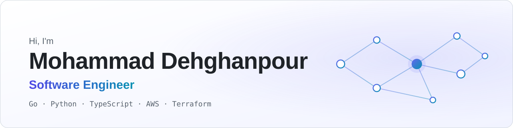

<picture>
  <source media="(prefers-color-scheme: dark)" srcset="assets/banner-dark.svg">
  
</picture>

Full-stack software engineer with 6+ years of experience building cloud-native,
event-driven systems on AWS. I like the hard parts: performance bottlenecks,
high-volume data pipelines and complex optimisation workflows, turned into
reliable, well-tested production services. I work across Go, Python, Node.js
and C# on the backend and React, TypeScript and Next.js on the frontend, with a
focus on clean architecture, automated testing, infrastructure as code and
secure APIs.

### Highlights

<table>
  <tr>
    <td width="50%" valign="top">
      <b>~70% faster image processing</b> 
      Found the bottlenecks in a large-scale image processing engine and rebuilt
      its hot paths with concurrency, better algorithms and low-level bit
      manipulation.
    </td>
    <td width="50%" valign="top">
      <b>Research to production</b> 
      Took forecasting and optimisation algorithms from data scientists into
      production services for workforce scheduling and energy trading.
    </td>
  </tr>
  <tr>
    <td width="50%" valign="top">
      <b>Reliable data at scale</b> 
      Designed pipelines that collect, validate and transform high-volume energy
      market, battery telemetry and workforce data for downstream models.
    </td>
    <td width="50%" valign="top">
      <b>Engineering foundations</b> 
      Built unit and integration testing, CI/CD pipelines and Terraform-managed
      infrastructure that made releases repeatable and safer.
    </td>
  </tr>
</table>

### Tech stack

<table>
  <tr>
    <td><b>Languages</b></td>
    <td>
      <picture>
        <source media="(prefers-color-scheme: dark)" srcset="https://skillicons.dev/icons?i=go,py,ts,js,cs&theme=dark">
        
      </picture>
    </td>
  </tr>
  <tr>
    <td><b>Backend and data</b></td>
    <td>
      <picture>
        <source media="(prefers-color-scheme: dark)" srcset="https://skillicons.dev/icons?i=nodejs,django,express,postgres,dynamodb,mongodb,mysql&theme=dark">
        
      </picture>
    </td>
  </tr>
  <tr>
    <td><b>Frontend</b></td>
    <td>
      <picture>
        <source media="(prefers-color-scheme: dark)" srcset="https://skillicons.dev/icons?i=react,nextjs,vue,angular,tailwind&theme=dark">
        
      </picture>
    </td>
  </tr>
  <tr>
    <td><b>Cloud and DevOps</b></td>
    <td>
      <picture>
        <source media="(prefers-color-scheme: dark)" srcset="https://skillicons.dev/icons?i=aws,terraform,docker,githubactions,bitbucket,linux&theme=dark">
        
      </picture>
    </td>
  </tr>
  <tr>
    <td><b>Machine learning</b></td>
    <td>
      <picture>
        <source media="(prefers-color-scheme: dark)" srcset="https://skillicons.dev/icons?i=tensorflow,opencv&theme=dark">
        
      </picture>
    </td>
  </tr>
</table>

**Also:** Gin, Serverless Framework, AWS Lambda, API Gateway, SQS, SES, S3,
Cognito, Auth0, role-based access control, OpenAPI/Swagger, microservices,
event-driven architecture, time-series processing, ETL pipelines, OCR, Retool,
Prismatic, Bubble.io, Autodesk Revit API.

### Selected work

#### Engineering drawing collaboration platform

A browser-based SaaS where architects, engineers and contractors combine large
PDF drawings into one master workbench, share it by link and mark it up
together from any device, with nothing to install.

**Challenge:** the image processing engine was too slow at scale. I redesigned
it around concurrent processing, optimised algorithms and low-level bit
manipulation, and made it about **70% faster**.

- Serverless microservices in Go (Gin) and Python on AWS Lambda and API Gateway,
  with OpenAPI contracts and Cognito/Auth0 authentication with role-based access
- React and TypeScript features for the drawing workbench
- A Django OCR service that extracts document text into PostgreSQL so content
  is indexed and searchable
- A C# Autodesk Revit plugin that exports BIM models to PDF and syncs them with
  the cloud platform automatically
- Unit and integration tests with generated mocks, plus automated deployment and
  infrastructure with Serverless Framework, Terraform and CI/CD pipelines

`Go` `Python` `C#` `React` `TypeScript` `AWS Lambda` `API Gateway` `DynamoDB` `S3` `SQS` `SES` `Cognito` `PostgreSQL` `Terraform` `Docker`

#### Workforce shift optimisation platform

An AI decision platform for shift-based businesses that turns demand forecasts
into automated, compliant staff rosters, piloted with a US coffee chain running
more than 70,000 shifts a week.

**Challenge:** turning forecasting models and data from many business systems
into configurable, production-grade workflows.

- Backend services that manage optimisation rules, process forecasting data and
  orchestrate end-to-end optimisation runs on an architecture built for
  high-volume scheduling calculations
- Data pipelines that turn workforce data from multiple business systems into
  consistent inputs for the forecasting and optimisation models
- Close work with data scientists and optimisation engineers to bring their
  algorithms into production
- React and TypeScript configuration apps where business users set scheduling
  rules, staffing constraints and forecast scenarios
- Internal tools and third-party integrations that cut support and operations
  effort significantly

`Python` `React` `TypeScript` `REST APIs` `Data pipelines` `AI embeddings` `Retool` `Prismatic` `Bubble.io`

#### Battery and energy trading optimisation platform

Forecasting, trading optimisation and automated bidding for battery owners and
portfolio managers in Australia's National Electricity Market, from sub-5 MW
sites to utility scale.

**Challenge:** processing high-volume, time-series market and telemetry data
reliably enough to drive trading decisions.

- Event-driven microservices on AWS for battery optimisation, forecasting
  workflows and market data processing
- Cloud pipelines that collect, validate and transform energy market and
  battery telemetry data
- Distributed services for time-series energy data that feed the optimisation
  algorithms
- APIs for forecasts, battery health metrics, optimisation recommendations and
  trading insights, plus React apps for operators to configure assets and
  review results

`Python` `React` `AWS` `Microservices` `Event-driven architecture` `REST APIs` `Time-series data`

#### Telegram gift marketplace

A Telegram Mini App marketplace for buying, selling, sending and withdrawing
Telegram collectible gifts.

**Challenge:** one payment backend over two very different rails: TON wallet
deposits and withdrawals through TonConnect, and Iranian Rial bank-card
payments with identity verification.

- APIs for marketplace search, filtering and cart checkout
- Telegram Premium and Stars purchases, giveaways with paid tickets and live
  leaderboards, referrals and admin moderation

`Python` `Node.js` `React` `TypeScript` `TON` `Telegram Mini Apps`

#### Health check-up app

Turns medical analysis results into an interactive body map that patients can
read at a glance.

**Challenge:** making medical results understandable for non-experts. I
modelled them as structured per-organ data, with scores, statuses and doctor
notes across dated visits.

- APIs for filterable, saveable health recommendations, user profiles and
  appointment history

`Python` `Node.js` `React`

#### More projects

- **Shared expense app.** Splits group costs four ways (equally, exact
  amounts, percentages or shares) and settles everyone up with the fewest
  payments. The challenge was getting money exactly right: all amounts are
  integer cents, splits use the largest remainder method, and property-based
  tests cover the algorithms. Go, PostgreSQL, React, TypeScript and Terraform
  on AWS (ECS Fargate, RDS, CloudFront), with CI/CD in GitHub Actions.
- **Serverless REST APIs on AWS.** Several Go services on Lambda, API Gateway
  and DynamoDB, with Swagger documentation, mocked dependencies and integration
  tests.
- **Landmark recognition.** Identifies famous landmarks in photos with deep
  learning, with tooling for annotating training data and detecting people in
  images. Python, TensorFlow, Keras and OpenCV.
- **Real-time chat.** Live messaging over WebSockets with a Node.js and Express
  server, Socket.IO, MongoDB and a Nuxt (Vue) client.

### Education

M.Sc. and B.Sc. in Computer Engineering (Software), both with a 4.0/4.0 GPA.

### Get in touch

